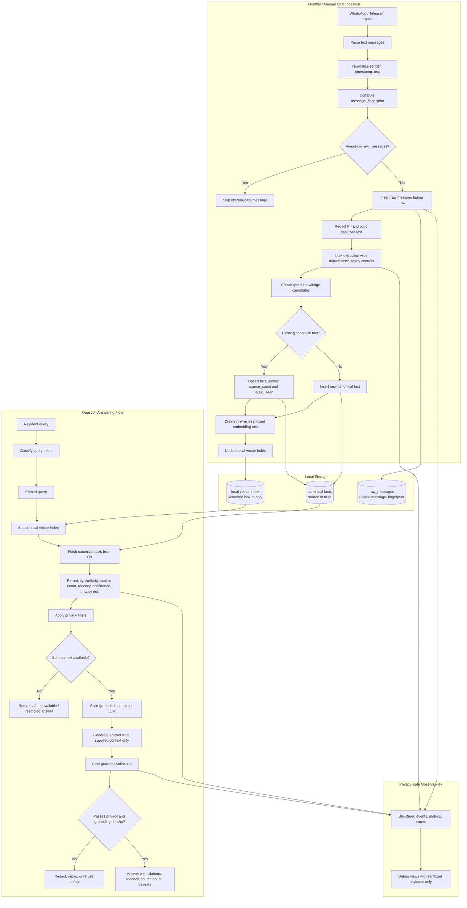

Now that the proposal is complete, here’s the **high-level architecture** I’d recommend. I’ll keep this at architecture level first; the detailed design can come next with schemas, APIs, ranking formulas, prompts, and module breakdown.

**High-Level Architecture**

The core shift should be from a keyword chatbot to a **privacy-aware community knowledge system**:

Detailed implementation design: [detailed-design.md](detailed-design.md)

```text
Manual chat input
  -> text parser
  -> normalization + contact detection
  -> privacy-aware extraction
  -> canonical knowledge store
  -> local vector index
  -> semantic retrieval + reranking
  -> grounded LLM answer
  -> privacy/support guardrails
  -> response with citations, recency, source counts
```

**Logic Flow Diagram**



The most important design decision: **do not make the vector store the source of truth**. Use a structured local database for canonical facts, and use the vector store as a semantic index over those facts.

```text
SQLite / local DB = truth
Local vector store = retrieval index
LLM = extraction and answer helper
Guardrails = final authority on privacy
```

AptJeeves 2.0 should be treated as a clean-slate LLM-based project. The earlier rule-based/non-LLM implementation belongs in the separate AptJeeves 1.0 project and should not be mixed into this design. Deterministic code still exists in AptJeeves 2.0, but only as infrastructure for parsing, normalization, hashing, redaction, dedupe, validation, and guardrails.

**1. Ingestion Layer**

Input starts manually from exported WhatsApp and Telegram chats. Non-text inputs are ignored in Phase 1.

The ingestion pipeline should parse messages into a normalized shape:

```text
import_batch_id
platform
source_conversation_id
chat_name
source_message_id, if available
message_fingerprint
sender_hash
sent_at_utc
normalized_text
sanitized_text
source_file
source_offset
```

The ingestion process must be idempotent because periodic/monthly imports may contain old duplicate messages. Each import can safely include the full chat history so far, but the pipeline should only process messages whose stable identity has not been seen before.

Use the platform's native message ID when available. If there is no native message ID, compute a deterministic `message_fingerprint` from a canonical representation:

```text
hash(
  platform,
  source_conversation_id,
  canonical_sender,
  normalized_sent_at_utc,
  normalized_text_hash,
  attachment_hashes_or_markers
)
```

Do not rely only on sender + datetime. That can collide or drift if exports change timestamp precision, timezone formatting, or message ordering. Sender + datetime is useful, but the fingerprint should also include the conversation/source identity and normalized content hash.

The raw message store should enforce uniqueness:

```text
raw_messages.message_fingerprint UNIQUE
```

Ingestion behavior should be:

```text
parse export
normalize sender/date/text
compute message_fingerprint
insert into raw_messages
skip if message_fingerprint already exists
send only newly inserted messages to extraction
```

This handles repeated monthly imports cleanly: old already-processed chat items are ignored, while old-but-previously-unseen messages are still processed.

Raw text should be treated as sensitive. Store either no raw text or only in a restricted debug/quarantine mode. The normal durable store should keep **sanitized snippets**.

Before any model call, run deterministic cleanup:

```text
normalize whitespace
remove media placeholders
detect phone numbers/emails/URLs
detect flat/address-like markers
replace sensitive values with placeholders
hash resident/sender identifiers
```

This lets the ML/LLM extractor reason over text like:

```text
"Contact CONTACT_12 for pest control. He charged Rs 1200."
```

rather than exposing the actual phone number unnecessarily.

**2. Extraction Layer**

Use **LLM-based extraction with deterministic safety controls**. This is not the AptJeeves 1.0 rule-based implementation; it is the AptJeeves 2.0 LLM pipeline plus deterministic infrastructure around it.

Deterministic infrastructure should handle:

```text
phone extraction
email extraction
URL extraction
timestamps
message fingerprinting and dedupe
hashing
redaction
reference counting
source tracking
privacy veto rules
```

LLM or ML should handle:

```text
topic classification
service type detection
process/how-to extraction
named entity extraction
vendor vs resident vs unknown classification
fact summarization
dedupe suggestions
confidence scoring
```

Extraction should also be idempotent at the knowledge-object level, not only at the message level. Two different messages may describe the same service contact, facility info, or process. The extractor should produce a suggested stable key for each extracted object so the canonical store can upsert instead of creating duplicates.

Example dedupe/upsert keys:

```text
service_contact_key = hash(service_type, normalized_name, normalized_contact_method)
process_info_key = hash(process_name, authority_or_provider, normalized_scope)
facility_info_key = hash(facility_name, info_type, normalized_value)
```

This gives you the best tradeoff: deterministic code protects privacy and consistency; the model handles messy apartment-chat language.

The extractor should produce typed knowledge objects, not one generic blob.

Core fact types:

```text
service_contact
process_info
facility_info
policy_or_rule
alert_or_issue
```

For Phase 1, I’d prioritize:

```text
service_contact
process_info
facility_info
```

**3. Privacy Model**

This is central, not an add-on.

Rule: **resident phone numbers must never be returned**.

Contacts should be classified as:

```text
vendor_or_service_contact
resident_contact
resident_affiliated_service_contact
apartment_staff_contact
unknown_contact
```

Domestic workers, maids, cooks, security, apartment facility staff, doctors, masseuses, beauticians, shops, and similar service providers can be treated as service contacts. If they are also residents, mark them clearly:

```text
is_resident_affiliated: true
resident_affiliation_reason: "same_apartment_address" | "explicit_resident_marker" | "sender_context" | "unknown"
```

Unknown contacts should default to restricted until enough evidence says they are safe to expose.

Privacy checks should happen at three points:

```text
before model calls
before storage/indexing
before final response
```

The final guardrail must be able to block or redact any resident PII even if retrieval or the LLM tries to include it.

**4. Canonical Knowledge Store**

Store extracted facts in a structured local DB.

For service contacts, store:

```text
fact_id
fact_type = service_contact
service_type
display_name
contact_methods
is_resident_affiliated
summary
sanitized_snippets
source_message_ids
source_count
first_seen
latest_seen
confidence
privacy_status
```

For process info, store:

```text
fact_id
fact_type = process_info
process_name
category
provider_or_authority
summary
steps
required_documents
fees
locations_or_portals
deadlines
caveats
sanitized_snippets
source_message_ids
source_count
first_seen
latest_seen
confidence
staleness_risk
```

Process examples include voter ID renewal, gas address update, school admission, property tax, e-khata, BBMP/BESCOM workflows, and similar resident-discussed procedures.

For government/process facts, answers should be careful: chat-derived information should be presented as community knowledge, not official legal truth.

**5. Local Vector Store**

Use a local vector store/index for semantic search. The vector entries should point back to DB fact IDs.

Do not embed raw sensitive text. Embed sanitized, retrieval-friendly text like:

```text
service_type + aliases + summary + sanitized snippets + tags
```

For process facts:

```text
process_name + authority + summary + steps + documents + caveats
```

The vector store should contain:

```text
vector_id
fact_id
fact_type
embedding_text
embedding
created_at
model_version
```

Good local options later could be SQLite vector extensions, LanceDB, Chroma, or FAISS, depending on how lightweight you want Phase 1 to be.

**6. Retrieval And Reranking**

The AI agent receives a query and performs retrieval in stages:

```text
classify query intent
embed query
semantic search in local vector store
fetch canonical facts from DB
rerank with metadata
apply privacy filters
select context for LLM
```

Reranking should combine semantic similarity with community-specific trust signals:

```text
final_score =
  semantic_similarity
  + source_count_boost
  + recency_boost
  + confidence_boost
  + fact_type_match_boost
  - stale_data_penalty
  - privacy_risk_penalty
```

For service contacts, source count and confidence matter a lot.

For process info, recency and staleness risk should matter more, because processes change.

**7. Answer Generation**

The LLM should not freely answer from memory. It should receive only retrieved, approved facts and be instructed:

```text
answer only from supplied context
do not expose resident phone numbers
include source count and latest mention
say when information is unavailable
mark government/process answers as resident-discussed info unless officially verified
```

Temperature should be low, but that is only one control. Grounding should come from:

```text
strict context
clear refusal rules
structured facts
citations/snippets
post-generation validation
```

Answers should include:

```text
direct answer
relevant contact or steps
latest mention date
source/reference count
confidence or caveat
sanitized citation snippets where useful
```

**8. Guardrails**

After the LLM produces an answer, run a final validation pass.

Guardrails should check:

```text
no resident phone numbers
no restricted emails
no raw flat/address details unless allowed
no unsupported claims outside retrieved facts
no leakage from sanitized snippets
no unsafe process certainty for govt/legal/admin topics
```

If the response fails, either redact and repair it or return a safe fallback.

Example safe fallback:

```text
I found related discussion, but the contact appears to be resident-linked or unverified, so I cannot share the phone number. I can share the general service/process details from the discussion.
```

**9. Observability And Debuggability**

Observability should be a first-class part of the architecture because the hard failures will not always look like crashes. The system needs to explain why a message was skipped, why a fact was updated, why a contact was restricted, why retrieval picked certain facts, and why the final answer was allowed or blocked.

The observability layer should follow the same privacy model as the product:

```text
no raw chat text in normal logs
no resident phone numbers or restricted PII in traces
use message_fingerprint, fact_id, query_id, import_batch_id, and trace_id for correlation
store sanitized prompt/context snapshots only
keep restricted raw payloads only in explicit debug/quarantine mode, if enabled
```

Use structured events instead of plain text logs. Each pipeline stage should emit compact records that can be filtered by import batch, message fingerprint, fact ID, query ID, and model/prompt version.

Core observability records:

```text
import_runs
pipeline_events
llm_calls
extraction_decisions
retrieval_traces
rerank_traces
guardrail_events
answer_events
feedback_events
```

Ingestion metrics should include:

```text
messages parsed
new messages inserted
duplicate messages skipped
parse failures
redaction counts by PII type
extraction candidates created
canonical facts inserted
canonical facts updated
privacy classifications by type
vector entries created or refreshed
```

Query metrics should include:

```text
query count
intent classification result
retrieval hit rate
top fact IDs and rerank scores
no-answer rate
guardrail block/repair rate
answer latency by stage
model, prompt, and embedding versions
token usage and estimated cost
```

For debugging, build a privacy-safe trace view for each import batch and user query.

An import trace should answer:

```text
which messages were new vs duplicates
which messages failed parsing
which messages produced knowledge candidates
which candidates were inserted vs merged into existing facts
which privacy rules changed or blocked a candidate
```

A query trace should answer:

```text
what intent was detected
which facts were retrieved
how facts were reranked
which facts were removed by privacy filters
what context was sent to the LLM
which final guardrails passed or failed
```

This also gives the system replayability. A specific import batch, message, fact, or query should be rerunnable after changing a parser, prompt, model, privacy rule, or ranking formula. Store enough version metadata to compare old and new behavior without guessing:

```text
parser_version
normalizer_version
redactor_version
extractor_prompt_version
llm_model_version
embedding_model_version
reranker_version
guardrail_version
```

For Phase 1, keep this local and simple: SQLite observability tables plus structured application logs are enough. A dashboard can come later, but the data model should be designed now so debugging does not depend on reading console output.

**10. Recommended Phase 1 Shape**

For Phase 1, build the system as local-first:

```text
local SQLite canonical DB
local observability tables
local vector store
manual idempotent chat ingestion
LLM extraction with deterministic privacy/dedupe controls
privacy-first contact classification
semantic RAG answer flow
no RBAC yet
```

I would not start with a fully autonomous “agent” doing lots of tool decisions. Start with a deterministic orchestration pipeline:

```text
QueryIntentClassifier
Retriever
Reranker
ContextBuilder
LLMAnswerer
GuardrailValidator
```

That will be easier to debug and safer. You can make it more agentic later.

**Architecture Verdict**

Your proposal is strong, with one key refinement: make this a **fact-centric architecture**, not a chat-centric or vector-store-centric one.

The durable product should be:

```text
community chats -> verified structured facts -> semantic retrieval -> grounded private answers
```

The two hard problems are ingestion quality and privacy classification. If those are designed well, the LLM answering layer becomes much simpler and safer.

For the detailed design next, I’d break it into:

```text
data model
ingestion pipeline
extraction schema
privacy rules
vector indexing strategy
retrieval/reranking formula
LLM prompts
guardrail checks
observability and replay strategy
module/file architecture
clean-slate AptJeeves 2.0 implementation plan
```
