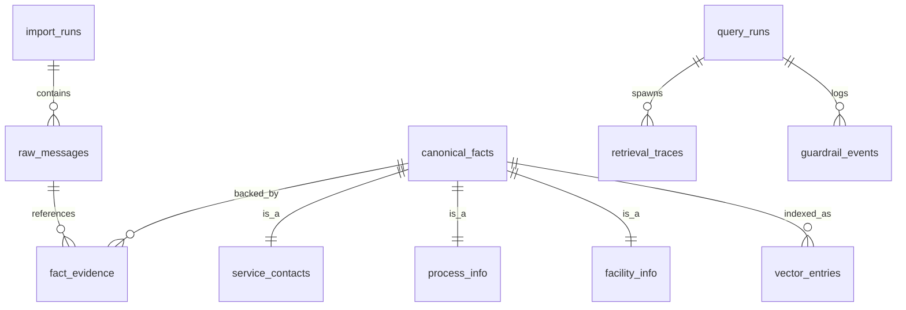

# AptJeeves 2.0 Comprehensive Detailed Design

This document is the consolidated detailed design and implementation manual for AptJeeves 2.0. It merges all core pipeline stage specifications, database schemas, CLI commands, FastAPI backend endpoints, and Vite-based React SPA frontend components into a single comprehensive source of truth.

AptJeeves 2.0 is a local-first, privacy-aware community knowledge assistant that can ingest exported apartment chats and answer resident queries using grounded, cited, and privacy-safe facts.

---

## 1. System Goals & Scope

### Primary Goals
- **Idempotency**: Ingest repeated monthly chat exports safely, skipping previously imported messages using stable fingerprints.
- **Privacy Redaction**: Redact PII (phone numbers, emails, flat numbers, URLs) deterministically before passing data to models or persistent storage.
- **Canonical Fact Store**: Store extracted structured facts in a local SQLite database as the source of truth, rather than relying on a vector database as the truth ledger.
- **Local Semantic Index**: Index facts using semantic vector embeddings (OpenAI `text-embedding-3-small` or local token embeddings) for quick retrieval.
- **Grounded Answering**: Generate resident answers purely from retrieved canonical context using low-temperature models (`gpt-4.1-mini`), preventing hallucinations.
- **Observability**: Expose detailed tracing for debugging, cost tracking, and safety auditing, integrated with Langfuse.
- **Replayability**: Rerun extraction, indexing, and queries using stored, sanitized inputs.
- **Web Dashboard**: Provide a responsive React web interface to chat, upload logs, manage settings, and inspect system logs.

### Scope & Non-Goals
- No migration path or dependencies on AptJeeves 1.0.
- No role-based access control (RBAC) or user permissions in Phase 1.
- No autonomous agent multi-tool loops; retrieval and answering follow a strict, deterministic sequence.
- No processing of raw media (images, voice notes, PDFs).
- No official legal verification of government/administrative guidelines (results are labeled as "community-discussed").

---

## 2. Directory Layout & Component Architecture

The codebase separates ingestion, privacy, extraction, storage, indexing, retrieval, answering, observability, and the API backend:

```text
src/
  aptjeeves/
    __init__.py           # Application initialization & centralized debug logging
    builders.py           # Centralized factory for LLM, embedding, and intent backends
    cli.py                # Command Line Interface (CLI) entrypoint
    config.py             # Configuration loader (.env loading and settings schemas)
    answering/
      formatter.py        # Fallback template-based answer formatter
      guardrails.py       # Final generated answer validator (PII & citation filter)
      llm_answerer.py     # OpenAI-backed grounded question answerer
    api/
      server.py           # FastAPI backend server with async background tasks
    extraction/
      fake_extractor.py   # Deterministic extractor used for offline testing
      llm_extractor.py    # OpenAI-backed fact extractor
      schemas.py          # Typed schemas for message inputs and fact candidates
      service.py          # Fact extraction queue processor
      validator.py        # Fact verification rules
    indexing/
      embeddings.py       # Local token embedding generator
      indexer.py          # Vector indexing queue orchestrator
      openai_embeddings.py# OpenAI-backed embedding model wrapper
      text_builder.py     # Embedding text representation builder
    ingestion/
      fingerprint.py      # Unique message fingerprint calculator
      hashing.py          # SHA256 hashing helpers
      normalizer.py       # Whitespace, timezone, and timestamp normalization
      parsers.py          # WhatsApp text parser and Telegram JSON parser
      service.py          # Ingestion ledger controller
      vcard.py            # VCF/vCard attachment parser helper
    observability/
      events.py           # SQLite database event logging service
      langfuse_client.py  # Langfuse singleton and Null wrapper for offline mode
      replay.py           # Operational replay engine
    privacy/
      detectors.py        # Regex-based PII scanners (phone, email, flats, URLs)
      redactor.py         # PII placeholder injector
    retrieval/
      context.py          # Query context constructor with privacy filtering
      intent.py           # Intent classifiers (OpenAI-backed and keyword-based)
      reranker.py         # Transparent metadata-based reranker formula
      retriever.py        # Cosine similarity retriever against active vectors
      service.py          # Cosine similarity retriever and reranker orchestrator
      traces.py           # Retrieval trace logger
    storage/
      db.py               # SQLite connection setup and migrations runner
      migrations/         # Raw SQL database migrations (001_initial.sql to 005_query_runs.sql)
      models.py           # Typed database dataclasses and schemas
      repositories.py     # SQLite repositories mapping tables to application models
tests/
  unit/                   # Parsers, normalizers, PII redaction, and intent tests
  integration/            # Idempotent imports, vector indexing, query RAG, and CLI tests
doc/
  architecture.md         # High-level architecture and logic flows
  detailed-design.md      # Unified system design (This Document)
  ui-implementation-plan.md # React SPA implementation phases
```

---

## 3. Local SQLite Schema (Canonical Data Model)

SQLite serves as the single source of truth. The vector index points back to DB fact IDs. All date-times are stored in UTC ISO 8601 strings with second precision (`YYYY-MM-DDTHH:MM:SSZ`).



### 3.1 `import_runs`
Tracks all batch ingestion events.
```sql
CREATE TABLE import_runs (
  import_batch_id TEXT PRIMARY KEY,
  source_platform TEXT NOT NULL,
  source_file TEXT NOT NULL,
  source_file_hash TEXT NOT NULL,
  chat_name TEXT,
  started_at TEXT NOT NULL,
  completed_at TEXT,
  status TEXT NOT NULL,          -- running, completed, completed_with_errors, failed
  parser_version TEXT NOT NULL,
  normalizer_version TEXT NOT NULL,
  redactor_version TEXT NOT NULL,
  total_messages_seen INTEGER NOT NULL DEFAULT 0,
  new_messages_inserted INTEGER NOT NULL DEFAULT 0,
  duplicate_messages_skipped INTEGER NOT NULL DEFAULT 0,
  parse_failures INTEGER NOT NULL DEFAULT 0,
  extraction_failures INTEGER NOT NULL DEFAULT 0,
  notes TEXT
);
```

### 3.2 `raw_messages`
The message ledger. `message_fingerprint` enforces strict database-level deduplication.
```sql
CREATE TABLE raw_messages (
  message_id TEXT PRIMARY KEY,
  message_fingerprint TEXT NOT NULL UNIQUE,
  import_batch_id TEXT NOT NULL,
  platform TEXT NOT NULL,
  source_conversation_id TEXT NOT NULL,
  chat_name TEXT,
  source_message_id TEXT,
  sender_hash TEXT NOT NULL,
  sender_display_hint TEXT,
  sent_at_utc TEXT NOT NULL,
  source_timezone TEXT,
  normalized_text_hash TEXT NOT NULL,
  sanitized_text TEXT NOT NULL,      -- Unredacted text is never written here
  raw_text_debug_ref TEXT,
  source_file TEXT NOT NULL,
  source_offset INTEGER,
  source_line_start INTEGER,
  source_line_end INTEGER,
  processing_status TEXT NOT NULL,   -- new, redacted, extracted, no_extractable_info, failed
  first_seen_at TEXT NOT NULL,
  processed_at TEXT,
  parser_version TEXT NOT NULL,
  normalizer_version TEXT NOT NULL,
  redactor_version TEXT NOT NULL,
  FOREIGN KEY (import_batch_id) REFERENCES import_runs(import_batch_id)
);
CREATE INDEX idx_raw_messages_import_batch ON raw_messages(import_batch_id);
CREATE INDEX idx_raw_messages_sent_at ON raw_messages(sent_at_utc);
```

### 3.3 `canonical_facts`
The polymorphic fact base table.
```sql
CREATE TABLE canonical_facts (
  fact_id TEXT PRIMARY KEY,
  fact_type TEXT NOT NULL,           -- service_contact, process_info, facility_info
  fact_identity_key TEXT NOT NULL UNIQUE,
  title TEXT NOT NULL,
  summary TEXT NOT NULL,
  privacy_status TEXT NOT NULL,      -- public_to_residents, restricted_resident_pii, restricted_unknown_contact, restricted_sensitive, needs_review
  confidence REAL NOT NULL,          -- 0.0 to 1.0
  source_count INTEGER NOT NULL DEFAULT 0,
  first_seen TEXT NOT NULL,
  latest_seen TEXT NOT NULL,
  created_at TEXT NOT NULL,
  updated_at TEXT NOT NULL,
  fact_version INTEGER NOT NULL DEFAULT 1,
  extractor_prompt_version TEXT,
  llm_model_version TEXT,
  merge_status TEXT NOT NULL DEFAULT 'active'
);
CREATE INDEX idx_canonical_facts_type ON canonical_facts(fact_type);
CREATE INDEX idx_canonical_facts_latest_seen ON canonical_facts(latest_seen);
```

### 3.4 `service_contacts`
Subtype details for service contacts (e.g., plumbers, carpenters).
```sql
CREATE TABLE service_contacts (
  fact_id TEXT PRIMARY KEY,
  service_type TEXT NOT NULL,
  display_name TEXT,
  normalized_name TEXT,
  contact_methods_json TEXT NOT NULL,       -- Stored with phone/email placeholders (e.g. PHONE_1)
  contact_method_hashes_json TEXT NOT NULL, -- SHA256 hashes of original contact methods
  contact_classification TEXT NOT NULL,     -- vendor_or_service_contact, resident_contact, resident_affiliated_service_contact, unknown_contact
  is_resident_affiliated INTEGER NOT NULL DEFAULT 0,
  resident_affiliation_reason TEXT,
  area_or_scope TEXT,
  price_hint TEXT,
  availability_hint TEXT,
  caveats TEXT,
  FOREIGN KEY (fact_id) REFERENCES canonical_facts(fact_id)
);
```

### 3.5 `process_info`
Subtype details for administrative/community procedures (e.g., Voter registration).
```sql
CREATE TABLE process_info (
  fact_id TEXT PRIMARY KEY,
  process_name TEXT NOT NULL,
  category TEXT,
  provider_or_authority TEXT,
  steps_json TEXT,                          -- JSON array of step strings
  required_documents_json TEXT,             -- JSON array of document titles
  fees_json TEXT,                           -- Fees and charges
  locations_or_portals_json TEXT,           -- URLs or physical office addresses
  deadlines_json TEXT,
  caveats TEXT,
  staleness_risk TEXT NOT NULL DEFAULT 'medium',
  official_verification_status TEXT NOT NULL DEFAULT 'not_verified',
  FOREIGN KEY (fact_id) REFERENCES canonical_facts(fact_id)
);
```

### 3.6 `facility_info`
Subtype details for apartment amenities.
```sql
CREATE TABLE facility_info (
  fact_id TEXT PRIMARY KEY,
  facility_name TEXT NOT NULL,
  info_type TEXT NOT NULL,
  location_hint TEXT,
  availability TEXT,
  rules_or_steps_json TEXT,
  caveats TEXT,
  FOREIGN KEY (fact_id) REFERENCES canonical_facts(fact_id)
);
```

### 3.7 `fact_evidence`
Links canonical facts to source raw messages for citations and calculations.
```sql
CREATE TABLE fact_evidence (
  evidence_id TEXT PRIMARY KEY,
  fact_id TEXT NOT NULL,
  message_id TEXT NOT NULL,
  message_fingerprint TEXT NOT NULL,
  sanitized_snippet TEXT NOT NULL,
  evidence_type TEXT NOT NULL,               -- mention, recommendation, correction, price_hint
  confidence REAL NOT NULL,
  created_at TEXT NOT NULL,
  FOREIGN KEY (fact_id) REFERENCES canonical_facts(fact_id),
  FOREIGN KEY (message_id) REFERENCES raw_messages(message_id),
  UNIQUE (fact_id, message_id, evidence_type)
);
CREATE INDEX idx_fact_evidence_fact_id ON fact_evidence(fact_id);
CREATE INDEX idx_fact_evidence_message_id ON fact_evidence(message_id);
```

### 3.8 `vector_entries`
Stores fact embeddings for retrieval.
```sql
CREATE TABLE vector_entries (
  vector_id TEXT PRIMARY KEY,
  fact_id TEXT NOT NULL,
  fact_type TEXT NOT NULL,
  fact_version INTEGER NOT NULL,
  embedding_text TEXT NOT NULL,
  embedding_hash TEXT NOT NULL,
  embedding_model_version TEXT NOT NULL,
  embedding_json TEXT NOT NULL,             -- JSON representation of float list
  vector_store_ref TEXT,
  created_at TEXT NOT NULL,
  updated_at TEXT NOT NULL,
  status TEXT NOT NULL,                     -- active, stale, failed, deleted
  FOREIGN KEY (fact_id) REFERENCES canonical_facts(fact_id)
);
CREATE UNIQUE INDEX idx_vector_entries_fact_id_active ON vector_entries(fact_id, embedding_model_version) WHERE status = 'active';
CREATE INDEX idx_vector_entries_fact_id ON vector_entries(fact_id);
CREATE INDEX idx_vector_entries_status ON vector_entries(status);
```

### 3.9 `query_runs`
Logs user requests and RAG execution statuses. Redacted query text is stored; raw query is discarded.
```sql
CREATE TABLE query_runs (
  query_id TEXT PRIMARY KEY,
  trace_id TEXT NOT NULL,
  status TEXT NOT NULL,                     -- running, completed, blocked, failed
  query_text_redacted TEXT NOT NULL,
  query_text_hash TEXT NOT NULL,
  query_intent TEXT,
  answerer_version TEXT,
  guardrail_version TEXT,
  retrieval_trace_id TEXT,
  final_action TEXT,                        -- pass, redact, refuse_safely, failed
  notes TEXT,
  created_at TEXT NOT NULL,
  completed_at TEXT
);
CREATE INDEX idx_query_runs_trace_id ON query_runs(trace_id);
CREATE INDEX idx_query_runs_status ON query_runs(status);
```

### 3.10 `retrieval_traces`
Auditing record for context retrieval parameters.
```sql
CREATE TABLE retrieval_traces (
  retrieval_trace_id TEXT PRIMARY KEY,
  query_id TEXT NOT NULL,
  trace_id TEXT NOT NULL,
  query_text_hash TEXT,
  query_intent TEXT,
  query_embedding_hash TEXT,
  candidate_fact_ids_json TEXT NOT NULL,     -- Ranked list of all matched facts
  selected_fact_ids_json TEXT NOT NULL,      -- Facts selected for the prompt context
  removed_by_privacy_json TEXT,              -- Facts filtered out due to privacy checks
  rerank_scores_json TEXT,                   -- Detailed scores for inspection
  created_at TEXT NOT NULL
);
CREATE INDEX idx_retrieval_traces_query_id ON retrieval_traces(query_id);
CREATE INDEX idx_retrieval_traces_trace_id ON retrieval_traces(trace_id);
```

### 3.11 `guardrail_events`
Audit ledger for guardrail triggers on generated answers.
```sql
CREATE TABLE guardrail_events (
  guardrail_event_id TEXT PRIMARY KEY,
  trace_id TEXT NOT NULL,
  query_id TEXT,
  fact_id TEXT,
  guardrail_name TEXT NOT NULL,
  action TEXT NOT NULL,                      -- pass, redact, refuse_safely
  reason TEXT NOT NULL,
  sanitized_payload_json TEXT,
  created_at TEXT NOT NULL
);
CREATE INDEX idx_guardrail_events_trace_id ON guardrail_events(trace_id);
CREATE INDEX idx_guardrail_events_query_id ON guardrail_events(query_id);
```

### 3.12 `pipeline_events`
Centralized application trace logging.
```sql
CREATE TABLE pipeline_events (
  event_id TEXT PRIMARY KEY,
  trace_id TEXT NOT NULL,
  event_type TEXT NOT NULL,
  stage TEXT NOT NULL,                       -- ingestion, extraction, indexing, retrieval, guardrails, replay
  severity TEXT NOT NULL,                    -- info, warning, error, success, started
  import_batch_id TEXT,
  message_id TEXT,
  fact_id TEXT,
  query_id TEXT,
  sanitized_payload_json TEXT,
  created_at TEXT NOT NULL
);
CREATE INDEX idx_pipeline_events_trace ON pipeline_events(trace_id);
CREATE INDEX idx_pipeline_events_import_batch ON pipeline_events(import_batch_id);
```

> [!NOTE]
> There is no SQLite table for `llm_calls`. Individual LLM API token counts, latencies, and costs are tracked using **Langfuse Tracing**, avoiding duplicate logging overhead and keeping SQLite local files light.

---

## 4. Pipeline Stages & Service Designs

### 4.1 Ingestion & Normalization
The `ChatIngestionService` handles chat parsing:
- **WhatsApp Parser**: Scans text lines matching standard timestamps, e.g., `dd/mm/yy, hh:mm - Sender: MessageText`. Supports multiline logs.
- **Telegram Parser**: Parses Telegram exported JSON structure (`messages` array, extracts `id`, `from`, `date`, `text`).
- **Normalizer**: Collapses redundant spaces, strips non-printable characters, and converts timestamps to UTC ISO format based on the configured default timezone (e.g. `Asia/Kolkata`).
- **Deduplication**: Computes a SHA-256 fingerprint:
  - If the platform has a stable native message ID, the fingerprint is computed as:
    $$\text{fingerprint} = \text{SHA256}(\text{platform} \parallel \text{conversation\_id} \parallel \text{source\_message\_id})$$
  - Otherwise, it falls back to the content hash formula:
    $$\text{fingerprint} = \text{SHA256}(\text{platform} \parallel \text{conversation\_id} \parallel \text{sender} \parallel \text{sent\_at\_utc} \parallel \text{text\_hash})$$
  Inserts matching fingerprints are skipped deterministically using SQLite `INSERT OR IGNORE`.
- **Deduplication CLI Output**: Returns counts for seen, inserted, and skipped messages.

### 4.2 Privacy & Redaction
The `PrivacyRedactor` implements regex and dictionary matches before data goes to model APIs or SQLite:
1. **Indian Phone Numbers**: Matches 10-digit formats, +91 prefixes, spaces/dashes. Pattern: `(?<!\w)(?:\+?91[\s-]?)?(?:0[\s-]?)?(?:[6-9]\d{4}[\s-]\d{5}|[6-9]\d{2}[\s-]?\d{3}[\s-]?\d{4}|[6-9]\d{9})(?!\w)`
2. **Emails**: Matches standard RFC 5322 regex. Pattern: `(?<![\w.+-])[\w.+-]+@[\w.-]+\.[A-Za-z]{2,}(?![\w.-])`
3. **URLs**: Matches standard web URLs. Pattern: `\b(?:https?://|www\.)[^\s<>()]+`
4. **Flat Numbers**: Identifies block prefixes followed by digits (e.g., A-101, B-402, Block C 204). Pattern: `(?ix)(?<!\w)((?:flat|apt|apartment|unit)\s*[A-Z]?\s*[-/]?\s*\d{2,4}[A-Z]?|[A-Z]\s*[-/]\s*\d{3,4}[A-Z]?)(?!\w)`
5. **Addresses**: Identifies block/building/tower indicators. Pattern: `\b(?:tower|block|building)\s+[A-Z0-9]{1,4}\b`
6. **Contacts**: Matches capitalized name-like word (3-20 letters) immediately following contact trigger words (`contact`, `call`, `ask`, `reach` etc.), excluding common stopwords (`for`, `the`, `our`, `him`, `her` etc.). Pattern: `(?i)(?:contact|call|ask|ping|reach|message|text)\s+([A-Za-z]{3,20})(?!\w)`

All matches are replaced with counters: `PHONE_1`, `EMAIL_1`, `FLAT_1`, `URL_1`, `ADDRESS_1`, `CONTACT_1`.
- **Hashed Senders**: Senders are stored as `SHA256(sender_name)` to prevent real-name leakage.
- **Contact Classification**: During extraction, entities are classified:
  - `vendor_or_service_contact` (plumbers, carpenters; public access allowed).
  - `resident_contact` (flat owners, tenants; restricted access).
  - `resident_affiliated_service_contact` (restricted by default unless explicitly classified as public service).

### 4.3 LLM Fact Extraction
`ExtractionService` groups newly inserted sanitized messages and calls the extractor:
- **Fake Extractor**: Converts mock prompts to fixed mock JSON outputs. Ideal for offline integration testing.
- **OpenAI LLM Extractor**: Invokes `gpt-4.1-mini` with a structured system prompt, forcing a JSON response that complies with the schema (identifies facts, subtype details, evidence snippets, confidence scores).
- **Fact Merging**:
  Calculates a unique `fact_identity_key`:
  - **Service Contacts**: `SHA256(service_type || normalized_name || hashed_contact_method)`
  - **Process Info**: `SHA256(process_name || provider_or_authority)`
  - **Facility Info**: `SHA256(facility_name || info_type)`
  If the key already exists in SQLite, the `CanonicalFactRepository` merges the facts:
  - Appends new fact evidence rows.
  - Updates the `latest_seen` date.
  - Increments `source_count`.
  - Re-evaluates description summary and increases `fact_version` if text content changes.

### 4.4 Vector Indexing
`VectorIndexingService` monitors fact updates:
- When a fact is modified and its `fact_version` increases, the active vector entry is marked `stale`.
- **Embedding Text construction**: Builds text context:
  - **Service Contacts**:
    `Fact type: service_contact\nService type: {service_type}\nName: {display_name}\nSummary: {summary}\nArea/scope: {area_or_scope}\nEvidence: {source_count} mentions, latest {latest_seen}\nCaveats: {caveats}`
  - **Process Info**:
    `Fact type: process_info\nProcess: {process_name}\nAuthority/provider: {provider_or_authority}\nSummary: {summary}\nSteps: {steps}\nDocuments: {required_documents}\nCaveats: {caveats}`
  - **Facility Info**:
    `Fact type: facility_info\nFacility: {facility_name}\nInfo type: {info_type}\nLocation: {location_hint}\nAvailability: {availability}\nRules/steps: {rules_or_steps}\nCaveats: {caveats}`
- **Embedding Models**:
  - **Local Token Embeddings**: Generates a fast token bag cosine-compatible vector representation (useful for local development).
  - **OpenAI Embeddings**: Calls `text-embedding-3-small` (1536-dimensions).
- Stale vector entries are updated and marked `active`.

### 4.5 Query, Intent, & Retrieval
`QueryService` processes RAG requests:
1. **Query Redaction**: Redacts the user query, creating a query run entry.
2. **Intent Classification**: Classifies queries into 6 categories:
   - `find_service_contact`
   - `ask_process_steps`
   - `ask_facility_info`
   - `ask_policy_or_rule`
   - `ask_alert_or_issue`
   - `general_or_unknown`
   Done via Keyword search or `gpt-4.1-mini`.
3. **Retrieval**: Embeds query, queries `vector_entries` with Cosine Similarity:
   $$\text{Similarity}(A, B) = \frac{A \cdot B}{\|A\| \|B\|}$$
4. **Metadata Reranking**: Re-scores facts:
   $$\text{Final Score} = \text{Similarity} \times 0.45 + \text{Source Boost} \times 0.15 + \text{Recency Decay} \times 0.15 + \text{Confidence} \times 0.15 + \text{Intent Match} \times 0.10$$
5. **Privacy Filtering**: Drops facts if they are marked `restricted` or if a service contact's status is `needs_review`.

### 4.6 Answer Generation & Formatter
- **Template Formatter**: Formats the selected facts into structured templates with citations (no LLM calls, deterministic fallback).
- **LLM Answerer**: Sends query and approved context to `gpt-4.1-mini` with a temperature of `0.1`. System prompt instructs:
  - Answer only using provided context.
  - State "I don't know" if facts are absent.
  - Append citations mentioning citation number, source count, and last seen date.
  - Present legal/process facts as "community-discussed".

### 4.7 Guardrails & Safety Fallbacks
The `GuardrailValidator` intercepts final outputs before returning them to the user:
- **Phone & Email Scanners**: Re-scans generated answers. If a real phone number or email is leaked (rather than a placeholder like `PHONE_1`), the guardrail blocks the output.
- **Unsanitized Snippets & Address Leakage**: Verifies that no unredacted unit/flat information has leaked.
- **Veto Rules**: If any check fails, it triggers the safety fallback:
  > *"I found related discussion, but the contact or details appear restricted or unverified, so I cannot share them. I can share the general service/process information from the discussion."*
- Logs decisions to the `guardrail_events` table.

### 4.8 Observability & Replay
- **Events Logging**: Writes JSON-formatted logs to `pipeline_events`.
- **Operations Replay**:
  - `replay-import`: Reruns extraction and vector indexing for an existing import batch without re-ingesting raw source files.
  - `replay-fact-index`: Reruns vector indexing for a single canonical fact.
  - `replay-query`: Replays a query from its stored redacted text, generating a new query run.
- **Langfuse Cloud Tracing**: `@observe()` decorators instrument key endpoints and functions. Absent API keys fall back gracefully to a mock `NullLangfuseClient` without performance hits.

---

## 5. CLI Command Reference

All CLI commands accept the global options:
- `--db PATH`: SQLite database file path override.
- `--apartment NAME`: Apartment chatbot selector slug, selecting the database file path `data_dir/apartments/<apartment_slug>/aptjeeves.sqlite3`.

### 5.1 `ingest`
Parses and normalizes WhatsApp/Telegram chat logs:
```powershell
python -m aptjeeves.cli ingest --platform [whatsapp|telegram] --file PATH [options]
```
Options:
- `--chat-name NAME`: Stable chat/channel name.
- `--timezone TZ`: Chat log timezone for parsing timestamps.
- `--date-order FMT`: Handing ambiguous dates (DMY or MDY, default: DMY).
- `--upload-dir PATH`: Directory containing uploaded attachments.

### 5.2 `import-status`
Shows a summary of a past ingestion batch:
```powershell
python -m aptjeeves.cli import-status --batch BATCH_ID
```

### 5.3 `query-status`
Fetches safety/auditing metrics for a past resident query:
```powershell
python -m aptjeeves.cli query-status --query-id QUERY_ID
```

### 5.4 `extract-pending`
Processes pending raw messages to extract structured canonical facts:
```powershell
python -m aptjeeves.cli extract-pending [--limit N]
```

### 5.5 `reset-failed`
Resets the processing status of failed messages back to `new` for re-processing:
```powershell
python -m aptjeeves.cli reset-failed
```

### 5.6 `index-facts`
Indexes canonical facts in the vector store:
```powershell
python -m aptjeeves.cli index-facts [--limit N]
```

### 5.7 `ask`
Answers a question using the RAG pipeline:
```powershell
python -m aptjeeves.cli ask "Your question" [--top-k K] [--max-facts N]
```

### 5.8 `replay-import`
Replays fact extraction and vector indexing on a past import batch:
```powershell
python -m aptjeeves.cli replay-import --batch BATCH_ID --from-stage extraction
```

### 5.9 `replay-fact-index`
Replaces the vector entry for a specific fact ID:
```powershell
python -m aptjeeves.cli replay-fact-index --fact FACT_ID
```

### 5.10 `replay-query`
Re-runs a past user query from its redacted text:
```powershell
python -m aptjeeves.cli replay-query --query-id QUERY_ID [--top-k K] [--max-facts N]
```

### 5.11 `show-events`
Prints a list of recent database pipeline events:
```powershell
python -m aptjeeves.cli show-events --limit N
```

---

## 6. FastAPI Backend API Reference

The FastAPI server provides backend endpoints and coordinates background execution:

### 6.1 Server Architecture
- **Tech Stack**: FastAPI, Uvicorn, Python standard logging.
- **CORS Middlewares**: Restricted to `http://localhost:5173` to prevent unauthorized cross-origin calls.
- **Background Tasks**: Long-running indexing and extraction tasks are executed in backend worker threads via FastAPI `BackgroundTasks`.

### 6.2 API Specifications
- **`GET /api/apartments`**
  - *Returns*: Array of strings representing available apartment database slugs.
- **`GET /api/{apartment}/status`**
  - *Returns*: Metrics on ingested messages, extracted facts, active vectors, and extraction queue status.
- **`POST /api/{apartment}/ask`**
  - *Body*: `AskRequest` (redacted/raw query text, top-k).
  - *Returns*: Answer text, citations array, confidence rating, intent type, and query run ID.
- **`GET /api/{apartment}/settings` & `POST /api/{apartment}/settings`**
  - *Read/Write*: Per-apartment configuration overrides (e.g. choice of embedding model, extraction backend).
- **`POST /api/{apartment}/upload`**
  - *Content*: Multipart form data (list of text/json export files, timezone, date-order formatting).
  - *Behavior*: Ingests raw messages, then triggers background extraction and indexing.
- **`GET /api/{apartment}/observability`**
  - *Returns*: Aggregated execution stats (token counts, LLM API costs, latencies).
- **`GET /api/{apartment}/logs`**
  - *Returns*: SQLite database logging entries (`pipeline_events` table).
- **`POST /api/{apartment}/reset-failed`**
  - *Behavior*: Re-queues messages that failed extraction by resetting their state back to `new`, preventing double charge of successful runs.

---

## 7. React Frontend SPA Reference

Built as a single page dashboard focused on administrative control and resident-facing assistant chat.

### 7.1 UI Technology Stack
- **Framework**: React with TypeScript, compiled using Vite.
- **Router**: React Router.
- **State Management**: TanStack React Query (polling active status, caching backend events).
- **Styling**: Tailwind CSS and Radix UI primitives.

### 7.2 Layout & Navigation
- **Persistent Sidebar**: Static navigation sidebar containing links to Chat, Ingestion, Stats, Usage, and Logs pages.
- **Global Context Selector**: Dropdown selector inside the sidebar to switch between active Apartment databases dynamically.

```text
+-------------------------------------------------------------+
|  Apartment  |                                               |
|  [Select v] |             ACTIVE COMPONENT VIEW             |
|-------------|                                               |
|  [ Chat ]   |  e.g. Chat Box, Citation Expanders,           |
|  [ Ingest ] |       Observability Cost Charts,              |
|  [ Stats ]  |       or Database Logs Viewer                 |
|  [ Usage ]  |                                               |
|  [ Logs ]   |                                               |
+-------------------------------------------------------------+
```

### 7.3 Page Views & Features
1. **Chat Panel**:
   - Dynamic message cards.
   - Grounded LLM citations shown as toggleable details underneath responses.
   - Visual badges for Confidence (`high`, `medium`, `none`) and safety warnings.
2. **Ingestion & Tasks**:
   - Folder Selector using HTML5 directory inputs. Matches files and guides the user to select the primary chat log.
   - Live progress bars indicating active background extraction and vector indexing tasks.
3. **Observability Cost Tracker**:
   - Aggregated metrics indicating OpenAI API token consumption, computed in dollars based on model pricing.
   - Latency breakdowns across intent classification, retrieval, embedding, and answering.
4. **Statistics**:
   - Displays number of active vectors, fact count breakdown by category, and queue sizes.
5. **Settings & Recovery**:
   - Per-apartment setting manager (model parameters).
   - "Reset Failed State" button to easily restart failed runs.
6. **Logs page**:
   - Live feed of database pipeline events.
   - Link tags that open direct Langfuse trace pages.

---

## 8. Automated Testing & Offline Safety

The test suite ensures total safety when changes are made.

### 8.1 Unit & Integration Testing
- **Unit Tests**: Coverage includes WhatsApp parsing regexes, Telegram JSON extraction structure, PII detection accuracy, and reranking scoring logic.
- **Integration Tests**: Tests monthly full-history updates (first import inserts $N$ messages, second import of same history inserts $0$ messages, third import of expanded history inserts only $M$ new messages). Verifies query flows with mock models.

### 8.2 Offline Testing Safety (Auto-Mocking)
To protect OpenAI and Langfuse API credits, `tests/conftest.py` declares an autouse fixture that intercepts and patches environment variables:
```python
@pytest.fixture(autouse=True)
def ensure_dotenv_loaded(monkeypatch) -> None:
    load_dotenv()
    # Disable Langfuse cloud communication
    monkeypatch.setenv("LANGFUSE_SECRET_KEY", "")
    monkeypatch.setenv("LANGFUSE_PUBLIC_KEY", "")
    monkeypatch.setenv("LANGFUSE_HOST", "")
    
    # Force mock and local backends to prevent network calls
    monkeypatch.setenv("APTJEEVES_EXTRACTION_BACKEND", "fake")
    monkeypatch.setenv("APTJEEVES_INTENT_BACKEND", "keyword")
    monkeypatch.setenv("APTJEEVES_EMBEDDING_MODEL", "local")
    monkeypatch.setenv("APTJEEVES_LLM_PROVIDER", "disabled")
```

---

## 9. Milestone History & Scope

The project completed 8 distinct development milestones:

- **Milestone 1**: Project layout, SQLite migration runner, raw message ingestion, and WhatsApp parser.
- **Milestone 1.1**: Telegram parser integration and chat metadata extraction.
- **Milestone 2**: Regex PII detectors (phone, email, flat, URLs) and redactor placeholder engine.
- **Milestone 3**: Extractor JSON validator, Canonical fact model repositories, and local Fake extractor.
- **Milestone 4**: Embedding text template builders, local token embeddings, and indexing queue processor.
- **Milestone 5**: Retrieval cosine calculator, transparent reranking formula, and template-based deterministic answering.
- **Milestone 6**: Post-generation guardrail validator, query runs ledger, query-status, and replay CLI tools.
- **Milestone 7**: OpenAI-backed LLMExtractor and Intent Classifier with keyword fallback.
- **Milestone 8**: FastAPI endpoints, React SPA dashboard components, folder uploads, and background worker threads.
